<!--
  Tudo aqui é SVG animado gerado por scripts/ e atualizado diariamente por
  .github/workflows/update-profile-art.yml — sem widgets de terceiros.
  Textos do card e cores: scripts/config.py
  Gotchas do GitHub: style inline é removido, <h1>/<h2> ganham sublinhado,
  nada de JS. Por isso os "prompts" são <h3> e a animação vive nos SVGs.
-->

<h3>christian@wyterlin:~$ whoami</h3>

<table>
<tr>
<td valign="top" width="370"></td>
<td valign="top" width="490"></td>
</tr>
</table>

<h3>christian@wyterlin:~$ git log --since="1 year ago" --graph</h3>

<h3>christian@wyterlin:~$ ls ~/projetos</h3>

<table>
<tr><th align="left">Projeto</th><th align="left">O que é</th><th align="left">Stack</th><th align="left">Status</th></tr>
<tr><td><b>AEGIS</b></td><td>Assistente de IA pessoal estilo JARVIS: memória persistente, tools modulares, rotinas automáticas</td><td>Python · LLM</td><td>🟢 em construção</td></tr>
<tr><td><b>sapb1-sql-scripts</b></td><td>Biblioteca de queries, TransactionNotification e procedures para SAP B1 on HANA</td><td>HANA SQL</td><td>🔧 refatorando</td></tr>
<tr><td><b>Obscura</b></td><td>Cofre de senhas com foco em segurança</td><td>Web · Crypto</td><td>🟡 pausado</td></tr>
<tr><td><a href="https://github.com/Wyterlin/performance-dashboard"><b>performance-dashboard</b></a></td><td>Dashboard de performance</td><td>Web</td><td>✅ público</td></tr>
<tr><td><a href="https://github.com/Wyterlin/my-website"><b>my-website</b></a></td><td>Portfólio pessoal</td><td>HTML · CSS · JS</td><td>🔄 repaginando</td></tr>
</table>

<h3>christian@wyterlin:~$ cat contato.txt</h3>

<a href="https://www.linkedin.com/in/christian-wyterlin-silveira">linkedin</a> &nbsp;/&nbsp;
<a href="mailto:christianwyterlin@gmail.com">email</a> &nbsp;/&nbsp;
<a href="https://instagram.com/cwyterlins">instagram</a>

