<!--
  Tudo aqui é SVG animado gerado por scripts/ e atualizado diariamente por
  .github/workflows/update-profile-art.yml — sem widgets de terceiros.
  Textos do card e cores: scripts/config.py
  Gotchas do GitHub: style inline é removido, <h1>/<h2> ganham sublinhado,
  nada de JS. Por isso os "prompts" são <h3> e a animação vive nos SVGs.
-->

<h3>christian@wyterlin:~$ whoami</h3>

<table>
<tr>
<td valign="top" width="370"></td>
<td valign="top" width="490"></td>
</tr>
</table>

<h3>christian@wyterlin:~$ git log --since="1 year ago" --graph</h3>

<h3>christian@wyterlin:~$ ls -la ~/projetos</h3>

Repositórios públicos: <a href="https://github.com/Wyterlin/performance-dashboard">performance-dashboard</a> · <a href="https://github.com/Wyterlin/my-website">my-website</a>

<h3>christian@wyterlin:~$ cat contato.txt</h3>

<a href="https://www.linkedin.com/in/christian-wyterlin-silveira">linkedin</a> &nbsp;/&nbsp;
<a href="mailto:christianwyterlin@gmail.com">email</a> &nbsp;/&nbsp;
<a href="https://instagram.com/cwyterlins">instagram</a>

